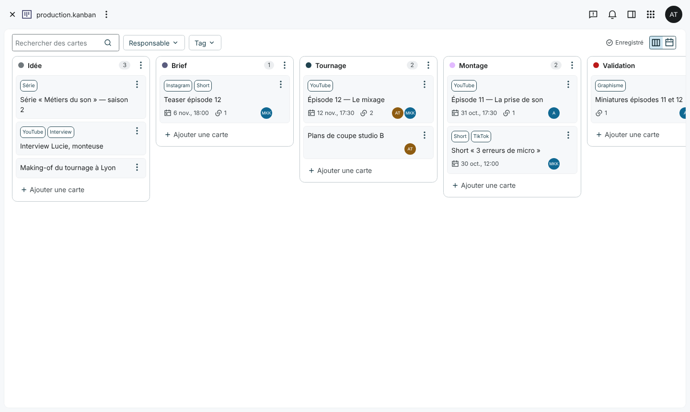
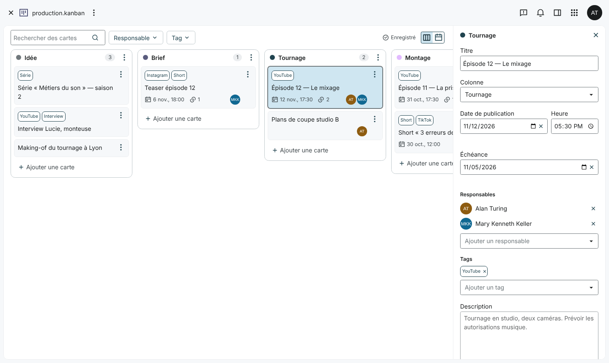
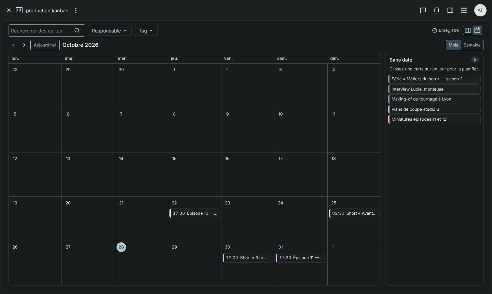

# Kanban pour OpenCloud

Le suivi des productions et le planning de publication dans [OpenCloud](https://github.com/opencloud-eu/opencloud),
comme un type de fichier natif : déposez un fichier `.kanban` dans un espace, cliquez dessus, et
toute l’équipe suit ses productions en kanban et ses publications en calendrier. Les cartes
pointent vers les fichiers et dossiers déjà présents dans l’espace.

_[English version](README.md)_



- **Tableau** : colonnes côte à côte, compteur de cartes, ajout rapide, glisser-déposer (souris,
  doigt, stylet) et menu **Déplacer vers…** pour le clavier. Les colonnes s’ajoutent, se
  renomment, changent de couleur, se réordonnent et se suppriment (leurs cartes sont déplacées
  ou supprimées, après confirmation).
- **Calendrier** : mois et semaine, cartes à leur date de publication, glisser une carte sur un
  autre jour (l’heure est conservée), glisser une carte sans date depuis la liste à côté. La
  semaine commence le lundi, le jour courant est marqué, les noms suivent la langue de
  l’utilisateur.
- **Détail d’une carte** dans le panneau latéral d’OpenCloud : titre, colonne, date et heure de
  publication, échéance, responsables (membres de l’espace), tags, description, fichiers et
  dossiers liés, historique.
- **Liens** vers les fichiers et dossiers de l’espace, choisis avec les sélecteurs d’OpenCloud.
  Un fichier renommé ou déplacé reste lié ; un fichier supprimé apparaît comme cassé, avec
  **Relier** et **Retirer**. Un fichier s’ouvre dans son application par défaut, un dossier dans
  Fichiers.
- **Filtres** par responsable, tag et texte, communs aux deux vues.
- **À plusieurs en même temps** : enregistrement automatique, gestion des conflits,
  modifications des autres visibles en une ou deux secondes, aucune modification perdue. Avec le
  serveur Yjs d’OpenCloud : qui a le tableau ouvert, et quelle carte chacun regarde.
- Thèmes clair et sombre, navigation au clavier, anglais et français, tablettes et téléphones.

> **Testé avec OpenCloud 9.0.0** (OpenCloud Web 8.2.1). L’application n’utilise que des API
> publiques de `@opencloud-eu/web-pkg` 8 : les autres versions 8.x d’OpenCloud Web devraient
> fonctionner, sans avoir été testées.

| Clair                                            | Sombre                                                    |
| ------------------------------------------------ | --------------------------------------------------------- |
|  |  |

## Sommaire

1. [Installation](#installation)
2. [Présence (optionnel)](#présence-optionnel)
3. [Utilisation](#utilisation)
4. [Travailler à plusieurs](#travailler-à-plusieurs)
5. [Format du fichier](#format-du-fichier)
6. [Limites connues](#limites-connues)
7. [Développement](#développement)

## Installation

### Depuis une release

Téléchargez `kanban-<version>.zip` et décompressez-le dans le dossier des applications web
d’OpenCloud. L’archive contient un dossier `kanban/`, comme les extensions officielles :

```bash
unzip kanban-0.1.1.zip -d "$OC_DATA_DIR/web/assets/apps/"
```

| Installation                                                           | Dossier des applications web                                                                                   |
| ---------------------------------------------------------------------- | -------------------------------------------------------------------------------------------------------------- |
| Binaire / paquet                                                       | `$OC_DATA_DIR/web/assets/apps/` (à créer si besoin)                                                            |
| [opencloud-compose](https://github.com/opencloud-eu/opencloud-compose) | `opencloud-compose/config/opencloud/apps/`                                                                     |
| Toute installation Docker                                              | `<dossier hôte monté sur OC_BASE_DATA_PATH>/web/assets/apps/`, ou montez le dossier avec `WEB_ASSET_APPS_PATH` |

Avec Docker, un volume convient aussi, par exemple dans le service `opencloud` d’un fichier
compose :

```yaml
environment:
  WEB_ASSET_APPS_PATH: /web/apps
volumes:
  - ./apps/kanban:/web/apps/kanban:ro
```

Redémarrez OpenCloud. Aucune entrée dans `apps.yaml` ni aucune autre configuration n’est
nécessaire. Rien n’est chargé hors d’OpenCloud : les icônes viennent du jeu Remix Icon qu’il
sert, les dates sont formatées avec la bibliothèque Luxon qu’il fournit déjà.

Vérifiez l’archive avec la somme de contrôle publiée :

```bash
sha256sum -c sha256sum.txt
```

### Depuis les sources

Prérequis : Node.js 22.18+ et pnpm 11.

```bash
git clone https://github.com/JulesMellot/opencloud-kanban.git
```

```bash
cd opencloud-kanban && pnpm install --frozen-lockfile && pnpm build
```

Copiez le contenu de `dist/` dans un dossier `kanban/` du dossier des applications web, ou
construisez l’archive de release avec `pnpm package`.

## Présence (optionnel)

Les tableaux se synchronisent par leur fichier et fonctionnent sans aucun service
supplémentaire. Pour voir aussi **qui a le tableau ouvert** (avatars dans la barre d’outils) et
**quelle carte chacun regarde** (avatar sur la carte), faites tourner le serveur Yjs d’OpenCloud
à côté, comme pour l’édition collaborative de l’éditeur de texte :

1. Lancez le conteneur `opencloudeu/yjs` (il ne stocke rien, il relaie seulement les messages
   entre navigateurs) avec `OPENCLOUD_URL` à l’adresse d’OpenCloud.
2. Faites passer `/yjs` vers lui par le proxy d’OpenCloud, sans protection (le jeton voyage dans
   la WebSocket et le serveur Yjs le vérifie lui-même), dans `proxy.yaml` :

   ```yaml
   additional_policies:
     - name: default
       routes:
         - endpoint: /yjs
           backend: http://yjs:1234
           unprotected: true
   ```

3. Définissez `WEB_OPTION_YJS_SERVER_URL=wss://<votre hôte OpenCloud>/yjs` sur le service
   OpenCloud et redémarrez-le.

[`docker-compose.yml`](docker-compose.yml) et [`dev/docker`](dev/docker) montrent une
installation complète. Cela active uniquement la présence : la salle ne contient aucune donnée
du tableau.

## Utilisation

- **Créer un tableau** : dans Fichiers, **Nouveau** → **Tableau kanban**. Il commence avec les
  colonnes Idée, Brief, Tournage, Montage, Validation, Planifié et Publié (dans la langue de
  l’utilisateur).
- **Ouvrir un tableau** : cliquez sur le fichier `.kanban`.
- **Ajouter une carte** : **Ajouter une carte** en bas d’une colonne (Entrée l’ajoute et laisse
  le champ ouvert pour la suivante), ou **+** sur un jour du calendrier.
- **Déplacer une carte** : glissez-la (sur écran tactile, appuyez longuement d’abord), ou ouvrez
  son menu **⋯** → **Déplacer vers…**, **Monter**, **Descendre**. Échap annule un glisser.
- **Planifier une carte** : glissez-la sur un jour du calendrier, ou réglez sa date de
  publication dans son détail. Une carte posée sur un jour pour la première fois reçoit 09:00.
- **Modifier une carte** : cliquez dessus. Les modifications s’enregistrent seules ;
  l’indicateur de la barre d’outils affiche **Enregistré**, **Enregistrement…** ou **Erreur
  d’enregistrement**.
- **Colonnes** : leur menu **⋯** les renomme, change leur couleur, les déplace et les supprime.
- **Changer de vue** avec les boutons à droite de la barre d’outils. La dernière vue est
  mémorisée par utilisateur, dans le navigateur.
- **Filtrer** avec le champ de recherche et les filtres **Responsable** et **Tag**. Ces deux
  filtres font partie de l’URL, comme ceux de la recherche de fichiers.

Les utilisateurs qui n’ont que la lecture du fichier voient le tableau avec un bandeau
**Lecture seule**, sans glisser-déposer ni modification.

## Travailler à plusieurs

Le fichier `.kanban` est le seul état partagé : aucun composant serveur, aucune base de
données.

- **Chaque modification est une opération** (ajouter une carte, la déplacer, changer un champ,
  supprimer une colonne…) appliquée au tableau. Elle désigne ce qu’elle modifie par son
  identifiant et place les cartes par rapport à leurs voisines, pour rester valable sur une
  version plus récente du fichier.
- **Enregistrement automatique** environ 800 ms après la dernière modification, avec `If-Match`
  sur l’etag de la version sur laquelle les modifications ont été faites. L’etag de la nouvelle
  version est lu dans la réponse de l’écriture elle-même.
- **Conflits** : si quelqu’un d’autre a enregistré entre-temps (412), la version plus récente
  est chargée, les opérations locales y sont rejouées et le résultat est enregistré. Les
  modifications sur des cartes différentes ou des champs différents d’une même carte sont
  toutes conservées ; pour un même champ, le dernier enregistrement l’emporte. Une opération
  qui ne s’applique plus (sa carte a été supprimée…) est abandonnée et un message indique
  laquelle.
- **Les modifications des autres** apparaissent sans recharger : le serveur annonce les
  écritures du fichier (server-sent events), l’etag est aussi vérifié toutes les 30 secondes et
  au retour sur l’onglet. Sans rien en attente localement, le tableau est simplement rafraîchi ;
  défilement, carte ouverte et filtres sont conservés.
- **Rien n’est perdu** : les opérations non enregistrées sont aussi gardées dans le navigateur
  (`localStorage`) et rejouées à la prochaine ouverture du tableau, après un plantage ou un
  onglet fermé. Si l’enregistrement échoue, le tableau garde les modifications, réessaie (2 s,
  5 s, 10 s, 30 s, puis toutes les minutes) et propose de copier le tableau avec les
  modifications. Quitter l’application avec des modifications non enregistrées demande
  confirmation.
- **Jamais écrasé** : un fichier qui n’est pas un tableau valide, ou qui a été écrit par une
  version plus récente, s’affiche en erreur et n’est jamais écrit. Si le fichier est remplacé
  par un contenu invalide pendant que le tableau est ouvert, l’enregistrement s’arrête et les
  modifications peuvent être copiées.

## Format du fichier

JSON, versionné : voir l’exemple dans la [version anglaise](README.md#file-format).

- **`color`** est le nom d’un rôle de couleur du design system d’OpenCloud, jamais un code
  couleur : `outline`, `tertiary`, `secondary`, `primary`, `inverse-primary`, `error` ou
  `on-surface`. Chaque thème les définit en clair et en sombre. Une valeur inconnue est
  conservée dans le fichier et affichée comme `outline`. (`chrome` n’est pas proposé : le thème
  d’OpenCloud ne le définit pas.)
- **`order`** trie les cartes d’une colonne (à égalité, par identifiant). Les valeurs sont
  fractionnaires : un déplacement ne modifie qu’une carte ; une colonne est renumérotée quand
  deux valeurs deviennent trop proches.
- **`dueDate`** est un jour (`YYYY-MM-DD`), **`publishDate`** une heure murale sans fuseau
  (`YYYY-MM-DDTHH:mm`) : 17:30 veut dire 17:30 pour tout le monde, y compris les jours de
  changement d’heure.
- **`links`** sont identifiés par `resourceId` ; `path` (relatif à l’espace) et `name` sont mis à
  jour quand la ressource a été déplacée ou renommée.
- **Les champs inconnus** sont conservés à tous les niveaux à l’enregistrement.
- **Validation** à l’ouverture : un JSON invalide, une `version` absente ou plus récente, ou un
  champ d’un mauvais type est signalé avec son emplacement (par exemple
  `cards[3].publishDate`) et le fichier n’est pas modifié. Une carte dont la colonne n’existe pas
  s’affiche dans la première colonne. Un fichier vide s’ouvre comme un nouveau tableau avec les
  colonnes par défaut.
- **Migrations** : `src/model/migrations.ts` contient une fonction par version passée, qui
  transforme un document de version `n` en version `n + 1`. La version 1 est la première, il n’y
  en a donc encore aucune.

## Limites connues

- **Le texte n’est pas fusionné caractère par caractère** : si deux personnes modifient en même
  temps le même champ de la même carte, le dernier enregistrement l’emporte. Les autres voient
  une modification une fois enregistrée, environ une seconde après la dernière frappe, pas
  pendant la saisie.
- **La présence** demande le serveur Yjs (voir plus haut) ; sans lui, personne ne voit qui
  d’autre est là, tout le reste fonctionne de la même façon.
- **Liens publics** : l’application n’ouvre les tableaux que pour les utilisateurs connectés.
- **Les sélecteurs** d’OpenCloud ne peuvent pas être limités à un espace : un fichier ou un
  dossier choisi dans un autre espace est refusé avec un message.
- **Les responsables** sont les membres de l’espace projet, groupes compris quand l’utilisateur
  peut lister les membres d’un groupe (à vérifier pour les utilisateurs non administrateurs sur
  votre installation) ; dans les autres espaces, tous les utilisateurs de l’instance peuvent être
  recherchés. Les noms sont enregistrés sur la carte au moment de l’attribution.
- **Historique** : pas d’annulation ; les versions précédentes du fichier sont dans ses
  **Versions** dans Fichiers.
- **Le champ d’heure** est celui du navigateur, au travers du champ texte du design system (qui
  ne déclare que quelques types de champ).
- **Gros tableaux** : tout le fichier est réécrit à chaque enregistrement, ce qui convient à des
  centaines de cartes, pas à des dizaines de milliers.
- **Console** : les avatars des utilisateurs sans photo font afficher une erreur 404 au
  navigateur, comme partout dans OpenCloud Web.

## Développement

Voir la [version anglaise](README.md#development) : commandes, environnement Docker de
développement (OpenCloud 9, serveur Yjs, Traefik) et tests.

## Licence

AGPL-3.0, voir [LICENSE](LICENSE).
